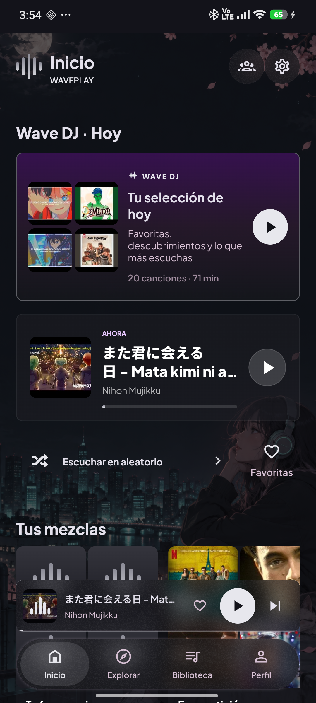
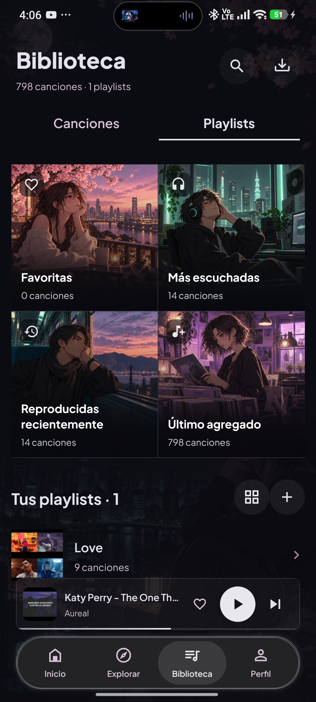
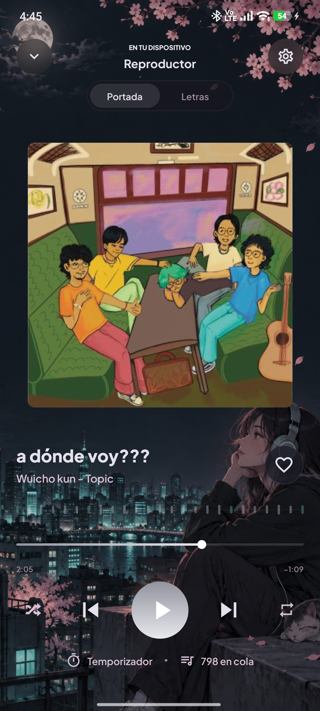

# WavePlay

Reproductor personal de música local para Android, construido con Expo Router y módulos nativos Kotlin. Incluye biblioteca del dispositivo, playlists, cola, favoritos, letras, historial, reproducción en segundo plano y descargas de contenido autorizado.

## Capturas de pantalla

| Inicio | Biblioteca | Reproductor |
| :---: | :---: | :---: |
|  |  |  |

## Desarrollo

Requisitos: Node.js compatible con Expo SDK 57, Android SDK y un teléfono o emulador Android.

```sh
npm ci
npx expo run:android
```

Expo Go no incluye los módulos nativos de WavePlay; usa una development build o un APK compilado desde `android/`. El proyecto nativo se conserva en el repositorio porque contiene el escáner, la gestión de etiquetas y el motor de descargas.

## Servicios opcionales

La biblioteca, la reproducción y la organización de archivos locales funcionan sin cuentas externas. Para activar una integración, copia [`.env.example`](.env.example) a `.env` y conserva solo las variables que vayas a usar. Expo incorpora los valores `EXPO_PUBLIC_*` en la aplicación. Guarda las claves privadas y los secretos de OAuth en el servidor correspondiente.

| Función | Variables y configuración |
| --- | --- |
| Búsqueda en Explorar | Activa YouTube Data API v3 en un proyecto propio de Google Cloud y configura `EXPO_PUBLIC_YOUTUBE_API_KEY`. Usa una clave restringida a la API necesaria. |
| Cuenta y salas de escucha | Crea un proyecto propio en Supabase. Configura `EXPO_PUBLIC_SUPABASE_URL` y `EXPO_PUBLIC_SUPABASE_PUBLISHABLE_KEY` con su URL y clave publicable. Para las salas, aplica las migraciones de `supabase/migrations/` tras configurar la limpieza de audio. |
| Inicio de sesión con Google | Activa el proveedor Google en Supabase Auth, registra el cliente web de OAuth y configura `EXPO_PUBLIC_GOOGLE_WEB_CLIENT_ID` con su ID. Registra también el paquete y la huella SHA-1 de tu compilación para el selector nativo de Android. Añade `waveplay:///auth/callback` a las URLs de redirección permitidas en Supabase. |
| API alternativa para audio | Configura `EXPO_PUBLIC_AUDIO_SERVICE_URL` con la URL de tu servicio. Para desarrollo, instala `yt-dlp` y FFmpeg y ejecuta `python server.py`. El servidor de ejemplo escucha en `127.0.0.1:8000`; la app necesita una URL accesible desde el dispositivo. |

Para configurar la limpieza de las salas, usa la URL de tu Edge Function `room-audio-cleanup` en `supabase/migrations/20261006143419_shared_room_audio.sql` antes de aplicar las migraciones. Crea `room_audio_cleanup_secret` en Vault y despliega la función incluida en `supabase/functions/room-audio-cleanup/`. El cron usa ese secreto para autorizar la llamada. Consulta las guías de [migraciones](https://supabase.com/docs/guides/deployment/database-migrations), [Vault](https://supabase.com/docs/guides/database/vault) e [inicio de sesión con Google](https://supabase.com/docs/guides/auth/social-sign-in/auth-google).

## Comprobaciones

```sh
npx tsc --noEmit
npx expo lint
node --test tests/*.test.cjs
```

## APK personal

El proyecto Android está configurado para `arm64-v8a`. Para compilar localmente:

```sh
cd android
./gradlew assembleRelease
```

La configuración actual usa una clave de depuración local para firmar el APK personal. `android/app/debug.keystore` no se publica: crea o proporciona tu propia clave antes de compilar. Para distribuir la aplicación a terceros, configura una clave de publicación independiente y revisa las políticas aplicables.

Las descargas deben limitarse a contenido propio, de dominio público o para el que tengas autorización, respetando las condiciones de cada plataforma.

## Licencia

El código de WavePlay se distribuye bajo la [licencia MIT](LICENSE).
